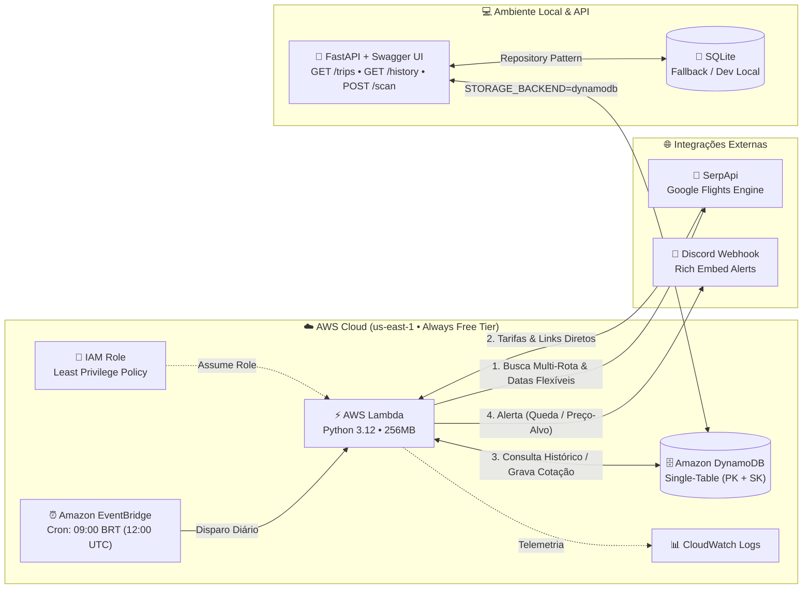

# ✈️ Flight Price Radar — Serverless Flight Monitoring & Alerting Pipeline

[](https://www.python.org/)
[](https://aws.amazon.com/lambda/)
[](https://aws.amazon.com/dynamodb/)
[](https://www.terraform.io/)
[](https://fastapi.tiangolo.com/)
[](#finops--estratégia-de-custo-zero)

Pipeline automatizado e orientado a eventos para monitoramento inteligente de tarifas aéreas, detecção de quedas de preço com deduplicação anti-spam, persistência histórica NoSQL e notificações em tempo real via Discord Webhooks — provisionado integralmente como código (**IaC**) na AWS sob orçamento **R$ 0,00 (Always Free Tier)**.

---

## 🏛️ Arquitetura do Sistema



---

## 🧠 Decisões de Engenharia & Padrões Aplicados

* **Repository & Strategy Pattern (`src/repository.py`):** Desacoplamento completo entre a regra de negócio e a camada de persistência. A aplicação alterna transparentemente entre **SQLite** (desenvolvimento/testes offline) e **Amazon DynamoDB** (produção serverless) por meio da variável de ambiente `STORAGE_BACKEND`.
* **DynamoDB Single-Table Design:** Modelagem otimizada para consultas de série temporal por viagem utilizando chave composta (`PK = TRIP#<NOME_DA_VIAGEM>` e `SK = <ISO_8601_TIMESTAMP>`), eliminando *scans* desnecessários e garantindo latência de milissegundos.
* **Motor Anti-Spam & Inteligência de Tarifa:** O pipeline calcula a média histórica, o menor preço já registrado e o último valor notificado antes de disparar alertas — evitando notificações repetidas quando o preço permanece estável e destacando apenas quedas reais ou atingimento de preço-alvo (`target_price`).
* **Infraestrutura como Código (Terraform) & Least Privilege:** Todos os recursos AWS são versionados em HCL (`terraform/`). A *IAM Role* da Lambda possui permissão restrita exclusivamente às ações `dynamodb:PutItem`, `dynamodb:Query` e `dynamodb:Scan` no ARN específico da tabela do projeto.
* **API REST Documentada (FastAPI):** Exposição de endpoints para inspeção do histórico de tarifas, estatísticas agregadas por rota, cadastro de novas viagens e disparo manual de varreduras com documentação interativa **OpenAPI / Swagger UI**.

---

## 💰 FinOps & Estratégia de Custo Zero

A arquitetura foi desenhada desde a concepção para operar indefinidamente dentro do **AWS Always Free Tier** e da cota gratuita da SerpApi:

| Serviço | Camada Utilizada | Limite Gratuito Mensal | Consumo Estimado | Custo |
| :--- | :--- | :--- | :--- | :--- |
| **AWS Lambda** | Always Free Tier | 1.000.000 requisições / 400k GB-s | ~30 execuções/mês | **US$ 0,00** |
| **Amazon DynamoDB** | On-Demand / Always Free | 25 GB armazenamento / 200M reqs | < 1 MB / ~180 reqs | **US$ 0,00** |
| **Amazon EventBridge** | Scheduled Rules | Gratuito para disparos Lambda | 30 eventos/mês | **US$ 0,00** |
| **SerpApi** | Free Plan (sem cartão) | 100 buscas/mês | ~60 buscas/mês | **US$ 0,00** |

---

## 📂 Estrutura do Projeto

```text
flight-price-radar/
├── src/
│   ├── api.py              # API REST FastAPI (/trips, /history, /scan, /health)
│   ├── client.py           # Cliente HTTP assíncrono/resiliente para SerpApi
│   ├── lambda_handler.py   # Entrypoint serverless invocado pelo EventBridge
│   ├── main.py             # Orquestrador do pipeline e regras de decisão de alerta
│   ├── notifier.py         # Formatação de Rich Embeds e envio via Discord Webhook
│   ├── repository.py       # Camada de persistência (SQLite + DynamoDB via boto3)
│   └── routes.json         # Configuração declarativa de rotas, aeroportos e preços-alvo
├── terraform/
│   ├── main.tf             # DynamoDB, IAM Role/Policy, Lambda Function e EventBridge
│   ├── variables.tf        # Parâmetros de região, projeto e segredos sensíveis
│   └── outputs.tf          # ARNs e nomes dos recursos provisionados
├── build_lambda.ps1        # Script de empacotamento cross-platform (Linux x86_64)
├── requirements.txt        # Dependências Python fixadas
└── .gitignore              # Proteção contra vazamento de .env, .tfstate e builds
```

---

## 🚀 Como Executar

### 1. Ambiente Local & API REST

```powershell
# Clone o repositório e ative o ambiente virtual
python -m venv venv
.\venv\Scripts\Activate.ps1
pip install -r requirements.txt

# Configure as variáveis de ambiente (.env)
# SERPAPI_KEY=sua_chave_serpapi
# DISCORD_WEBHOOK_URL=sua_url_webhook_discord

# Execute uma varredura manual (grava em SQLite local)
python -m src.main

# Inicie a API REST com documentação Swagger interativa
uvicorn src.api:app --reload
# Acesse: [http://127.0.0.1:8000/docs](http://127.0.0.1:8000/docs)
```

### 2. Deploy Serverless na AWS (Terraform)

Pré-requisitos: **AWS CLI** autenticado (`aws configure`) e **Terraform >= 1.5**.

```powershell
# 1. Gere o pacote ZIP compatível com AWS Lambda (Linux x86_64)
.\build_lambda.ps1

# 2. Carregue as variáveis do .env e provisione a infraestrutura
Get-Content .env | ForEach-Object {
    if ($_ -match "^([^#=]+)=(.*)$") {
        [Environment]::SetEnvironmentVariable($matches[1].Trim(), $matches[2].Trim(), "Process")
    }
}

cd terraform
terraform init
terraform apply -var="serpapi_key=$env:SERPAPI_KEY" -var="discord_webhook_url=$env:DISCORD_WEBHOOK_URL" -auto-approve
cd ..

# 3. Teste uma invocação real na nuvem
aws lambda invoke --function-name flight-price-radar-worker --region us-east-1 response.json
Get-Content response.json; Remove-Item response.json
```

---

## 🔌 Endpoints da API (`FastAPI`)

| Método | Endpoint | Descrição |
| :--- | :--- | :--- |
| `GET` | `/health` | Health check do serviço |
| `GET` | `/trips` | Lista todas as viagens configuradas enriquecidas com estatísticas (`avg_price`, `min_price`, `last_notified_price`) |
| `POST` | `/trips` | Cadastra uma nova viagem monitorada no `routes.json` |
| `GET` | `/history` | Retorna o histórico cronológico de cotações (com filtro opcional por `trip_name`) |
| `POST` | `/scan` | Dispara manualmente o pipeline completo de busca, análise e notificação |